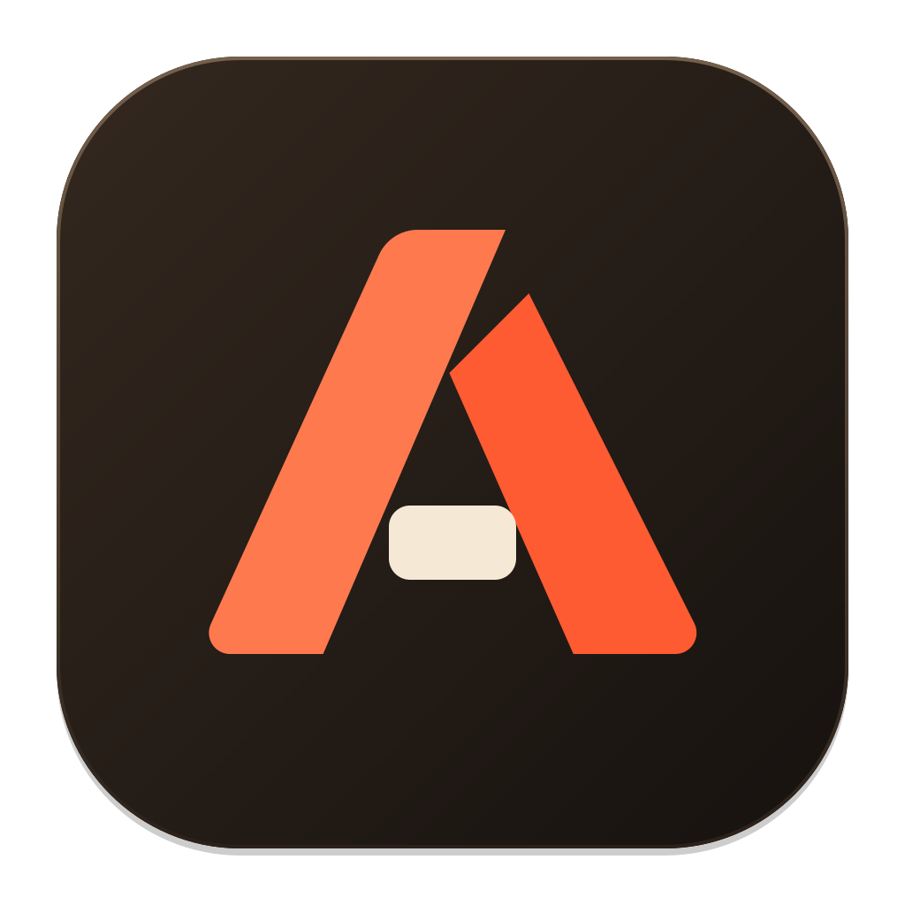
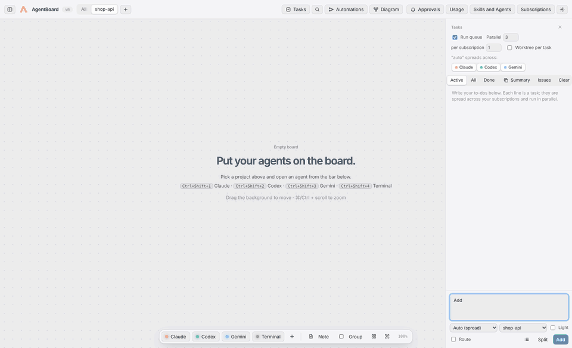
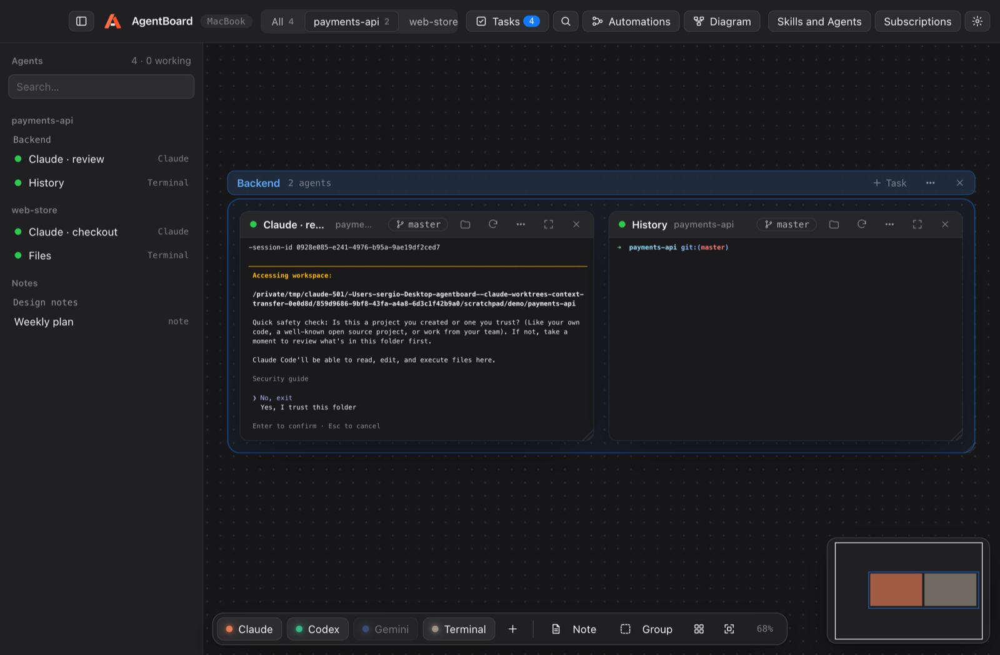
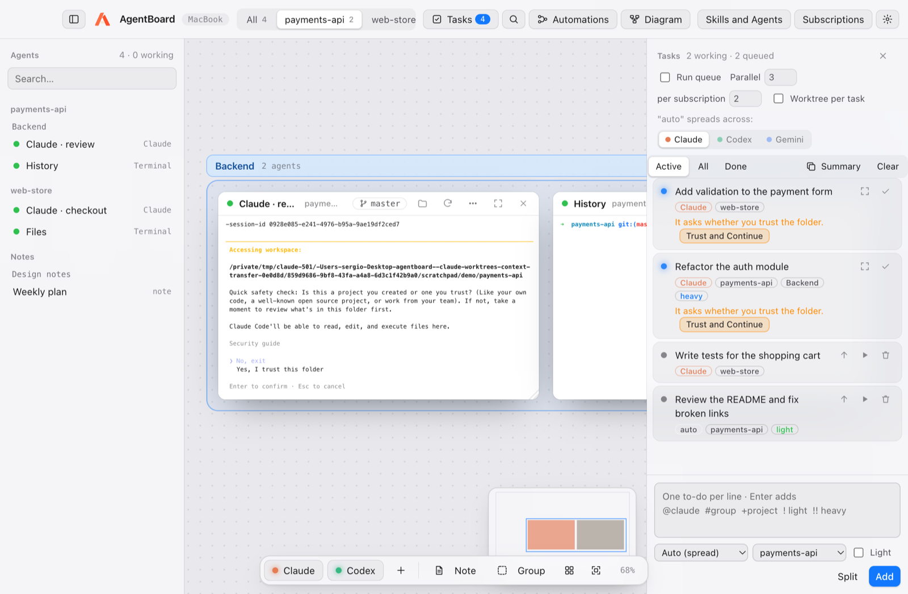
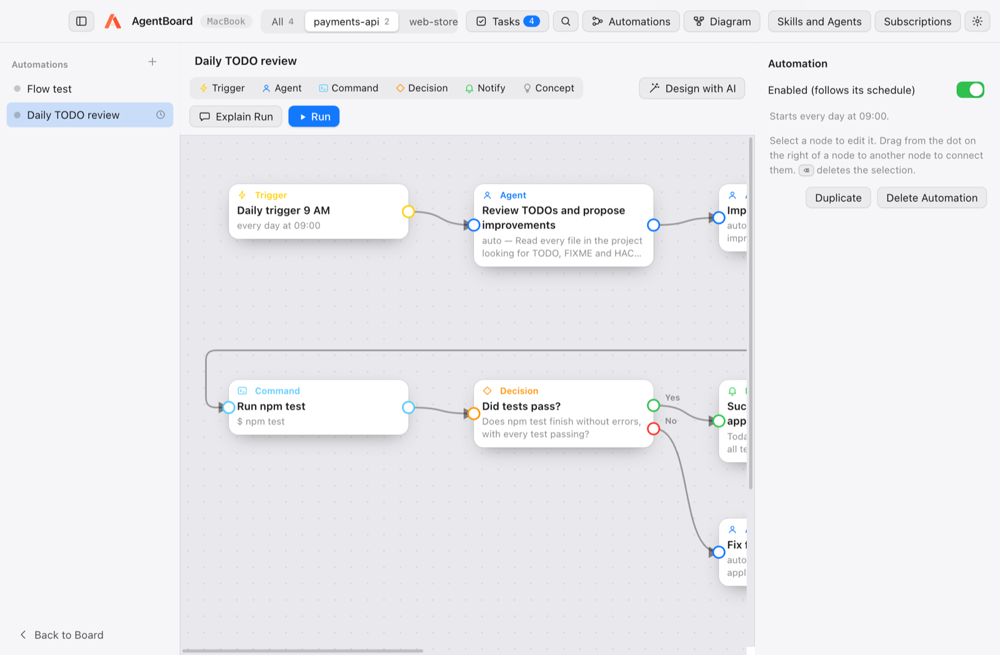
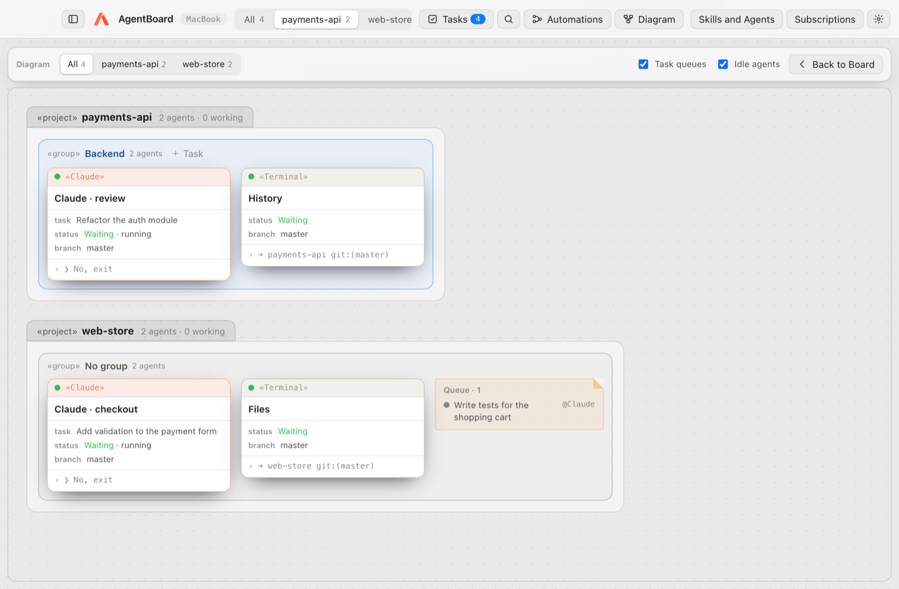
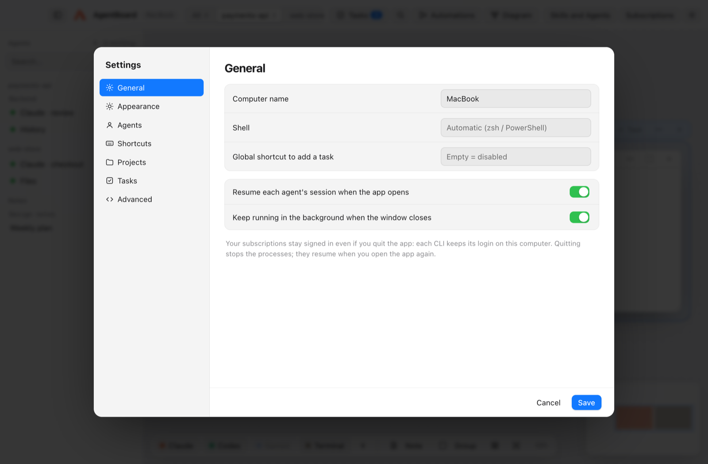
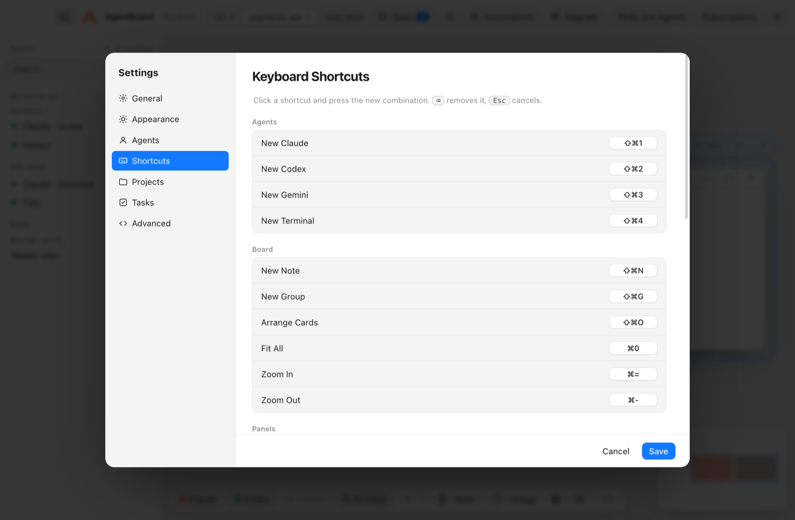
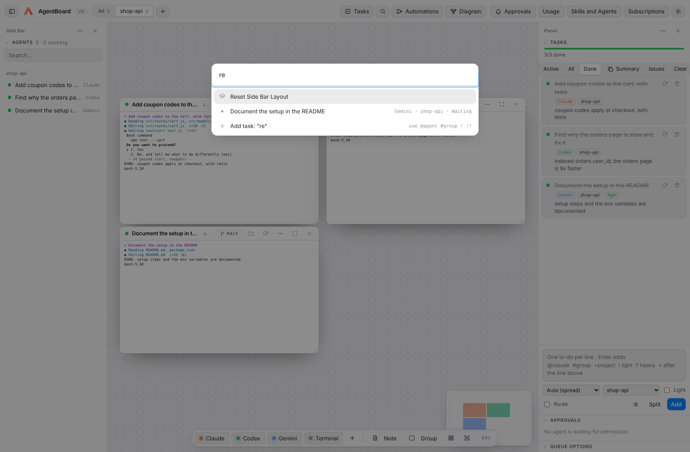

<p align="center">
  
</p>

<h1 align="center">AgentBoard</h1>

<p align="center">
  A workspace for coding agents: Claude Code, Codex, Gemini CLI and others, side by side,<br/>
  on your own subscriptions, on Mac, Windows and Linux.
</p>

<p align="center">
  <a href="https://github.com/scortes5/agentboard/releases/latest"></a>
  <a href="https://github.com/scortes5/agentboard/releases"></a>
  <a href="https://github.com/scortes5/agentboard/actions/workflows/ci.yml"></a>
  
  <a href="LICENSE"></a>
  <a href="https://github.com/scortes5/agentboard/stargazers"></a>
</p>

<p align="center">
  <a href="https://github.com/scortes5/agentboard/releases/latest"><b>Download</b></a> ·
  <a href="docs/GUIDE.md">Getting started</a> ·
  <a href="https://github.com/scortes5/agentboard/wiki">Wiki</a> ·
  <a href="CHANGELOG.md">Changelog</a> ·
  <a href="https://github.com/scortes5/agentboard/discussions">Discussions</a>
</p>



AgentBoard is a desktop app that puts your AI agents on one board. Each card is a real terminal running the agent's CLI inside your project. From there you give them tasks, see what each one is doing, coordinate them and automate whole workflows.

It uses no API keys and sends nothing to servers of its own: it runs the programs you already have installed (`claude`, `codex`, `gemini`…) with the session you already signed in to.

> **First time?** The [Getting started guide](docs/GUIDE.md) explains everything step by step, with no prior knowledge assumed.

> **Like it?** A ⭐ on the repo helps other people find AgentBoard.

---

## Contents

- [What you can do](#what-you-can-do)
- [Installation](#installation)
- [Board and projects](#board-and-projects)
- [Tasks](#tasks)
- [Automations](#automations)
- [Diagram](#diagram)
- [Usage and savings](#usage-and-savings)
- [Settings and shortcuts](#settings-and-shortcuts)
- [Remote control and integrations](#remote-control-and-integrations)
- [Subscriptions and accounts](#subscriptions-and-accounts)
- [Token saving](#token-saving)
- [Agent connection](#agent-connection)
- [Privacy and security](#privacy-and-security)
- [Development](#development)
- [Known limitations](#known-limitations)
- [Contributing](#contributing)

---

## What you can do

| | |
|---|---|
| **Many agents at once** | Real terminals on an infinite board, each with its agent, project and git branch. |
| **Projects in parallel** | Each project is a tab with its own view; all keep working while you look at another. |
| **Tasks** | Write your to-dos and they are spread across your subscriptions, several at a time. |
| **Automations** | n8n-style step diagrams run by your agents. The AI can design and explain them. |
| **Diagram** | A per-project, per-group, per-agent view of what each one is doing. |
| **From your phone** | See the tasks, approve what agents ask and add tasks from your phone's browser. |
| **Ground rules** | Write once what every agent must follow (commit as you, ask before deleting…). |
| **Background** | Closing the window does not stop the agents; your sessions are kept. |
| **Token saving** | A fresh session per task, light mode, compact-context skills and load spreading across accounts. |



### Why not just tmux or a few terminal tabs?

| | Terminal tabs / tmux | AgentBoard |
|---|---|---|
| Several agents at once | Yes | Yes, on one visual board |
| See who is working, waiting or stuck | Check each tab | Status on every card, notifications, Diagram view |
| Spread a to-do list across agents and plans | By hand | Task queue with parallelism limits |
| Plan runs out of usage | You notice and switch | The task moves to another subscription |
| Agents editing the same repo | Conflicts | Worktree per task, then review, merge or discard |
| Agents talking to each other | No | Built-in MCP bridge |
| Repeatable workflows | Shell scripts | Visual automations the AI can design and explain |

---

## Installation

### Option 1: download the installer

From [Releases](https://github.com/scortes5/agentboard/releases/latest):

| System | File |
|---|---|
| Mac with Apple Silicon (M1, M2…) | `AgentBoard-x.y.z-arm64.dmg` |
| Mac with Intel | `AgentBoard-x.y.z.dmg` |
| Windows | `AgentBoard-Setup-x.y.z.exe` (`AgentBoard.Setup.x.y.z.exe` up to 0.5.0) |
| Linux (x64) | `AgentBoard-x.y.z.AppImage` (from 1.2.0) |

The app is not signed. The first time:
- **Mac**: open AgentBoard once, press *Done* in the warning, then go to **System Settings → Privacy & Security**, scroll to *Security* and press **Open Anyway**. Or, in Terminal: `xattr -cr /Applications/AgentBoard.app`. (Right-click → *Open* no longer works on macOS 15 and later.)
- **Windows**: in the SmartScreen warning, *More info* → *Run anyway*.
- **Linux**: make it executable and open it: `chmod +x AgentBoard-*.AppImage && ./AgentBoard-*.AppImage`. On distributions without FUSE 2 (Ubuntu 22.04 and later), install `libfuse2` first.

### Updates

AgentBoard looks for a new release when it opens and every six hours (turn it off in **Settings → General → Check for updates automatically**; **AgentBoard → Check for Updates…** on Mac, or **Board → Check for Updates…** on Windows, checks right away).

- **Windows**: the new version downloads in the background. When it is ready, a notice offers **Restart to Update**; if you choose **Later**, it installs the next time you quit.
- **Mac**: a notice says which version is available. **Download** opens the `.dmg` for your Mac (Apple Silicon or Intel) in the browser; open it and drag AgentBoard to *Applications* to replace the old one. Your board and settings are kept.
- **Linux**: the notice's **Download** gets the new `.AppImage`; make it executable and open it instead of the old one.

Silent updates on Mac (download and install with no `.dmg`) need the app to be signed and notarized with an Apple Developer ID, which this project does not have yet. When you run AgentBoard from source, it only shows the notice; update with `git pull`.

### Option 2: from source

Requirements: [Node.js 20+](https://nodejs.org) and [git](https://git-scm.com).

```bash
git clone https://github.com/scortes5/agentboard.git
cd agentboard
npm install
npm run app
```

`npm run app` builds the app with its icon and installs it in *Applications* (Mac) or opens the installer (Windows). To try it without installing: `npm start`.

### The agents

AgentBoard uses whichever CLIs you have installed. Install at least one and sign in once:

```bash
npm i -g @anthropic-ai/claude-code   # then: claude   (Pro or Max plan)
npm i -g @openai/codex               # then: codex    (ChatGPT Plus or Pro)
npm i -g @google/gemini-cli          # then: gemini   (Google account)
```

Copilot CLI, Cursor CLI, Qwen Code, OpenCode, Aider, Amp and local models through Ollama or LM Studio also work (see [Subscriptions and accounts](#subscriptions-and-accounts)). `npm run check` shows which ones are available.

---

## Board and projects

- **Cards**: each one is a real terminal (PTY) that opens the agent in the project folder. It shows its status (*working*, *waiting* or *stopped*), the git branch and uncommitted changes; clicking the branch lets you switch it or create a new one.
- **Project tabs**: the toolbar shows *All* and each project, with how many agents it has and whether any is working. `+` opens another folder as a project. Each tab remembers its view.
- **Groups**: frames that gather a team of agents (for example *Backend* or *Frontend*). Moving the frame moves its cards. **Arrange** lays everything out while keeping the groups.
- **Notes** on the same board, a **minimap** at the bottom right and the **agent list** on the left.
- **Side bars like VS Code**: the left and right bars hold views (**Agents**, **Tasks**, **Approvals**, **Queue Options**).
  - Click a view's title to collapse it.
  - Drag its title to reorder it or to move it to the other side.
  - Hide it from its **⋯** menu; the bar's **⋯** shows it again or resets the layout.
  - Drag a bar's inner edge to resize it (double-click the edge for the default width), and the line between two views to share the height.
  - The layout is saved with your board.
- **Close several at once**: ⌘/Ctrl or Shift + click title bars to select cards, then **Close**. The palette also closes finished-task cards, stopped cards or the whole view, and a group's menu closes its cards.
- **Options menu** on each card (three dots): rename it, change its agent, project or arguments (for example `--model opus`), duplicate it, or **Send to…** another agent a piece of the conversation.
- **Help on every button**: hold the pointer over a button for 2 seconds to see what it does.

Closing the window keeps the app running in the background (menu bar icon). Quitting with ⌘Q asks for confirmation; when you open it again, each Claude card resumes **its own** conversation (`--resume <id>`), even with several in the same project.

---

## Tasks



**Tasks** button (⇧⌘T). Write one to-do per line and press Enter:

```
fix the Google login #backend
@claude write tests for the payments API
update the README !
refactor the payments module !!
```

| Syntax | Meaning |
|---|---|
| `@claude`, `@codex`… | Which subscription does it. Without `@` it is **auto**: the one with the least work. |
| `#group` | The agent opens inside that board group (created if it does not exist). |
| `+project` | Which project it runs in. |
| `!` | **Light**: a cheaper model (for example haiku). |
| `!!` | **Heavy**: a more capable model (for example opus). |
| `>` at the start | Wait for the task on the line above before starting. |

- Each task runs in a **fresh session** and updates itself: *Done* when the agent writes `DONE: …`, *Needs your review* when it is waiting for an answer, *Blocked* with `BLOCKED: …`.
- **Parallel** and **per subscription** limit how many run at once; with *Run queue* on, queued tasks start by themselves when there is room.
- **Worktree per task**: each task works on its own branch (`agentboard/<task>`), so several agents do not step on each other in the same repository. When it finishes, **View changes** shows what it did and lets you **Merge** or **Discard**.
- **Usage limit**: if a subscription runs out, the task moves to another one and the exhausted one waits for its reset time.
- **Route** (on by default): when you add tasks, Claude's cheapest model (haiku, one short call with no terminal) splits what you wrote into independent tasks and picks the subscription and the model (light or heavy) for each one; the queue then runs them in parallel. Markers you write (`@agent`, `#group`, `+project`, `!`, `!!`) always win. Turn it off in the composer or in *Settings → Tasks*. Without Claude installed, lines are added as they are.
- **Split**: paste free text and Claude breaks it into tasks, without starting them.
- **Live progress**: a bar with done, working, blocked and errors; under each running task, its time, last output line and the subagents it opened. A card that prints an error turns red and notifies you.
- **Approvals inbox**: every agent asking for permission, in one list under **Approvals**; approve or reject without visiting each card.
- **Review and undo**: **Review** shows a task's full diff; click a line to quote it and send comments back to its agent, then **Merge**, **Create Pull Request** or **Discard**. Without a worktree, each task starts from a checkpoint and **Undo** puts the project back exactly as it was.
- **Checks after each task**: set a command per project (for example `npm test`). If it fails, the output goes back to the same agent until it passes (or the task is marked blocked).
- **Cross-review** (optional): another subscription reviews each finished task and approves it or sends the problems back.
- **Dependencies and templates**: start a line with `>` to make it wait for the one above; insert frequent to-dos from **Templates**.
- **Limits and budgets**: if a subscription runs out, its tasks move to another; if all of them do, AgentBoard tells you when the first one comes back (with an idea for the break). Tokens per task are shown live, with optional budgets per task, per day, per week and per month, for all projects or for each one; you get a notice at 80% and 100%.
- **Subagents you can see**: with *Agent Connection* on, a task agent may split its work with `start_agent`; each helper opens as a `↳` card next to it.
- **GitHub issues**: **Issues** lists the project's open issues (needs the `gh` CLI signed in), with their labels, age, author, comments and assignees; filter them by text or label, select several (or all) and queue them, or turn one into a ready-to-run *Fix a GitHub issue* automation; the agent reads the issue and its pull request says `Closes #n`. Issues written by people outside the project are flagged and show their text first, and the agent is told to treat any issue's text as a description, never as instructions.
- **Branches**: the branch button shows every branch of the chosen project, the ones being worked on first: the tasks and agent cards on each, its worktree, its last commit, how far it is from the main branch, whether it is pushed, and its pull request with the state of its checks. **Pull All** and **Push** keep the branches in step with GitHub (and every 15 minutes, branches that are not checked out follow GitHub on their own); **Graph** draws every branch as a colored line, showing where each one splits and is merged, with each commit's files. It also shows the issue each branch works on, and **Clean Up** deletes merged branches and unused task worktrees after you review them. Switch to one or copy its name from there; a card's branch pill has the same view under *All branches…*.
- **Summary**: copies what was done today and what is pending, as Markdown (or sends it every day to a chat, see below).
- **Global shortcut** (⌃⌥Space, configurable): add a task from any app.

---

## Automations



**Automations** button (⇧⌘F). A flow is a diagram of connected steps:

| Step | What it does |
|---|---|
| **Trigger** | When it starts: by hand, every N minutes, every day at a set time, when a task finishes, or when a new GitHub issue is opened. |
| **Agent** | An agent does a piece of work. It becomes a queued task, with its subscription and model. |
| **Command** | A command in the project (tests, build, git), with a time limit. If it fails, only what is connected to its red *On error* output runs. |
| **Decision** | Claude reads the previous result and answers yes or no; the flow continues down that branch. |
| **Notify** | A notification. |
| **Concept** | An idea written on the diagram; it does not run. |

- Connect steps by dragging from the dot on the right of one onto another. The right panel edits the selected step.
- **If a step fails**: *Agent* and *Command* steps have a red *On error* output for what to do then (for example, an agent that fixes the failing tests); agent steps can give up after a time limit so a run never hangs.
- **Templates**: start from a ready-made automation for the current project: fix a GitHub issue → checks → pull request, nightly tests that fix themselves, review my changes before committing, update dependencies safely, keep the docs up to date, triage open issues.
- **Design with AI**: describe what you want in your own words and Claude builds (or changes) the diagram.
- **Explain Run**: the AI explains what will happen step by step, what may fail and how to improve it.
- **Run**: independent branches run in parallel. Each agent receives only a one-line summary of the previous steps, not their whole history.
- Scheduled automations run while AgentBoard is open, including in the background.
- **Secrets** (*Settings → Secrets*): passwords and API keys for your automations, for example to log in to an app with a Playwright script. Each value is encrypted with your system keychain and never shown again. A **Command** step gets a secret as an environment variable when it mentions it (`$APP_PASSWORD`) or lists it under *Secrets it can use*, and the value is hidden in its output. Agents never see secrets. On Linux the vault needs a keyring (GNOME Keyring or KWallet); without one it refuses to store them rather than keep plain text.

---

## Diagram



**Diagram** button (⇧⌘D). A UML-style view with one package per project and, inside, its groups and agents. Each agent shows its subscription, task, status, time working, branch and last line of output; task queues appear as notes, and arrows show who handed work to whom. Clicking an agent takes you to its card.

---

## Usage and savings

**Usage** button (⇧⌘U). A heatmap of your daily activity over the last year (by tokens, sessions or tasks done), plus:

- **Usage**: total tokens, sessions and tasks.
- **Savings and effectiveness**: tokens saved by the prompt cache and its hit rate, share of tasks solved, and median time and tokens per task.
- **By subscription** and **by project**: where your tokens go.

It reads the Claude Code and Codex logs on this computer (every Claude account included) and only adds up token counters; nothing leaves your machine.
- **Cost by project**: tokens per project today, this week and this month, with the last 30 days as small bars, and **Budgets**: how far along each budget is (set them in *Settings → Tasks* and *Settings → Projects*).

---

## Settings and shortcuts



**Settings** (⌘,), by section:

- **General**: computer name, shell, global shortcut, resuming sessions and running in the background.
- **Appearance**: light, dark or automatic theme; accent color; interface size; typeface (SF Pro or Geist); terminal font size, theme and line height. With a live preview.
- **Agents**: each agent's command and arguments (for resuming, light mode and heavy mode), and custom agents for any CLI.
- **Ground Rules**: rules every agent follows, written once. They go into each CLI's own instructions file (`~/.claude/CLAUDE.md`, `~/.codex/AGENTS.md`, `~/.gemini/GEMINI.md`…) inside a marked block, so the rest of the file stays yours and agents you open by hand follow them too.
- **Shortcuts**: all editable; click one and press the new combination.
- **Security**: rules for permission requests (*dangerous*: flagged in red, never approved in bulk or from the phone; *approve automatically*: for commands that only read or test) and the activity log (what was approved and by whom, remote devices, automation commands, secrets saved or removed).
- **Projects**, **Tasks**, **Secrets**, **Integrations** and **Advanced** (every setting as JSON, to add or remove keys).



| Action | Mac | Windows |
|---|---|---|
| New Claude / Codex / Gemini / Terminal | ⇧⌘1 / 2 / 3 / 4 | Ctrl+Shift+1 / 2 / 3 / 4 |
| New note / new group | ⇧⌘N / ⇧⌘G | Ctrl+Shift+N / G |
| Tasks / Diagram / Automations | ⇧⌘T / ⇧⌘D / ⇧⌘F | Ctrl+Shift+T / D / F |
| Usage and savings | ⇧⌘U | Ctrl+Shift+U |
| Search or run (palette) | ⇧⌘P | Ctrl+Shift+P |
| Next / previous / all projects | ⌘⌥→ / ⌘⌥← / ⌘⌥0 | Ctrl+Alt+→ / ← / 0 |
| Agent list | ⇧⌘A | Ctrl+Shift+A |
| Arrange / fit all | ⇧⌘O / ⌘0 | Ctrl+Shift+O / Ctrl+0 |
| Shortcuts / Settings | ⌘/ / ⌘, | Ctrl+/ / Ctrl+, |
| Add a task from any app | ⌃⌥Space | Ctrl+Alt+Space |
| Zoom / pan | ⌘ + scroll / drag the background | Ctrl + scroll / same |



The **palette** (⇧⌘P or the magnifier) finds agents, tasks, projects and actions; if you type something that does not exist, Enter adds it as a task.

---

## Remote control and integrations

*Settings → Integrations*:

- **Remote control**: turn on *Let my phone control AgentBoard*, save, and open the link on your phone, on the same Wi-Fi. You see the tasks live, approve or reject what the agents ask, and add tasks. Every request needs the random token in the link (it travels in the `#` part, which the browser never sends to servers); **New Link** makes the old one stop working. The page uses HTTPS with a certificate made on your computer (the phone asks once to trust it; compare the SHA-256 fingerprint shown in Settings). It turns itself off after 8 hours by default, each new device is announced and logged, too many wrong links block that address for a few minutes, and requests flagged as dangerous can only be approved at the computer.
- **Daily summary**: create an incoming webhook in Slack, Discord, Teams or Google Chat, paste its URL (kept encrypted in Secrets) and pick a time. Once a day, today's done and pending tasks are sent to that channel. **Send Test** sends it now.

---

## Subscriptions and accounts

**Subscriptions** button:

- **CLIs**: Claude Code, Codex, Gemini CLI, Copilot CLI, Cursor CLI, Qwen Code, OpenCode, Aider and Amp. It shows which are installed and signed in; you can install them or sign in from there.
- **Several Claude accounts**: if you have more than one plan (for example personal and work), add each account. Each one uses its own folder (`~/.claude-<name>`), with its login, history and skills, and the queue spreads work across them.
- **Local models**: detects [Ollama](https://ollama.com) and [LM Studio](https://lmstudio.ai) and opens their models as a chat, with Codex or with Aider.

**Are sessions closed when the app closes?** No. Each CLI keeps its login on your computer (macOS Keychain, `~/.codex`, `~/.gemini`). AgentBoard only checks that it exists; it never reads, copies or sends your credentials.

---

## Token saving

- **A fresh session per task**: each task starts with a clean context.
- **Light mode** (`!`) for simple tasks.
- **Spreading across subscriptions and accounts**: you do not burn through a single one's limit.
- **Minimal context in automations**: each step gets a one-line summary of the previous ones.
- **Bundled skills** (*Skills and Agents → Token Saving*), installed into Claude Code, Codex and Gemini:
  - `context-saving`: search before reading, read only what is needed, short answers.
  - `agentboard-task`: stay on the task, do not step on other agents, report when done.
  - `compact-handoff`: delegate with a short summary, not the whole history.

---

## Agent connection

In *Skills and Agents → Agent Connection*, one click registers AgentBoard as an MCP server in each CLI. From then on, every agent can:

| Tool | Use |
|---|---|
| `list_agents` | See the agents on the board and their status. |
| `send_to_agent` / `read_agent_output` | Ask another agent for something and read its answer. |
| `start_agent` | Open a new agent with a task; `light: true` uses its cheap model. |
| `list_tasks` / `add_task` / `complete_task` | Use the task list: hand out work and mark it done. |

Example, in Claude: *"ask Codex what it thinks of this change and summarize its comments"*.

---

## Privacy and security

- Everything runs on your computer. AgentBoard has no server and no telemetry. The only request it makes on its own is the update check to GitHub (`api.github.com` on Mac, the release files on Windows), which sends nothing about you or your board and can be turned off.
- Each CLI keeps its credentials where it always does; AgentBoard does not read or copy them.
- The board is saved outside your repositories, readable only by your user:

  | System | Path |
  |---|---|
  | Mac | `~/Library/Application Support/AgentBoard/board.json` |
  | Windows | `%APPDATA%\AgentBoard\board.json` |

- The agent bridge is a local socket with a random token. It only writes to cards running an agent (never to a plain terminal), each card can turn it off, and it has a messages-per-minute limit.
- **Agents run with your permissions**: they can do anything you can on this computer. Approve requests after reading them; *Settings → Security* flags dangerous ones (`rm -rf`, `git push --force`, `curl … | sh`, `.env`…), keeps them out of **Approve All** and the phone, and logs every answer.
- **Text from outside is data, not instructions**: GitHub issues are fenced in the agent's prompt, with outsiders' issues flagged before you queue them.
- The window runs in Chromium's sandbox with context isolation and a strict content security policy: what a terminal prints cannot run code.
- Optional, and off by default: the phone remote (an HTTPS page on your local network that needs the random token in its link, turns itself off after some hours and logs each device), the daily summary (sent only to the webhook you paste, whose URL is kept encrypted) and GitHub issues (read through your own `gh` CLI). Ground rules are written only to the CLIs' instructions files, inside a marked block.
- Secrets are encrypted with your system keychain (`secrets.json` in the app's data folder, readable only by your user). The window can list their names but not read them; only the automation commands that ask for a secret get its value, as an environment variable, and it is hidden in their output.

---

## Development

```bash
npm install        # installs dependencies (and fixes node-pty permissions)
npm start          # opens the app in development mode
npm run app        # builds and installs the app
npm run dist:mac   # builds the .dmg files  ·  npm run dist:win  builds the .exe
npm run icon       # regenerates the icons from src/assets/logo.svg
npm test           # unit and open/closed tests
npm run test:e2e   # opens the real app and drives a task with a fake agent (Linux: xvfb-run -a npm run test:e2e)
```

When a new `version` in `package.json` reaches `main`, the `.github/workflows/build.yml` workflow builds the Mac and Windows installers and publishes the Release with its `v<version>` tag, together with `latest.yml` and the `.blockmap` that the Windows app uses to update itself. Every push and pull request runs the `ci` workflow and CodeQL code scanning; Dependabot keeps npm packages and GitHub Actions up to date.

To see the update notice from source, pretend to run an older version: `AGENTBOARD_FAKE_VERSION=0.1.0 npm start` (the check runs 10 seconds after opening).

```
src/main/        main process: one folder per area (app, core, shell, terminals, git, agents,
                 library, ai, bridge, updates); index.js wires the services together
src/preload/     the only bridge between the interface and the main process
src/renderer/    the window: core, board, watchers, tasks, review, settings, flows, diagram…
skills-pack/     token-saving skills
scripts/         MCP server, app install and icons
test/            unit, open/closed and end-to-end tests
docs/            guide and screenshots
```

See the wiki's [Architecture](https://github.com/scortes5/agentboard/wiki/Architecture) page for the classes and how to extend the app by adding files.

---

## Known limitations

- The *working* or *waiting* status is estimated from the terminal's recent output, not from the agent's API.
- Scheduled automations only run while AgentBoard is open (it can be in the background).
- The board does not sync between computers, on purpose: each machine has its own projects. To copy it, copy `board.json`.
- The app is not signed with an Apple or Microsoft certificate. Because of that, Mac updates are downloaded by hand (see [Updates](#updates)).

---

## Contributing

Bug reports, ideas and pull requests are welcome. Start with [CONTRIBUTING.md](CONTRIBUTING.md), browse the [wiki](https://github.com/scortes5/agentboard/wiki) for how the code fits together, and ask anything in [Discussions](https://github.com/scortes5/agentboard/discussions). Security problems: see [SECURITY.md](SECURITY.md).

If AgentBoard saves you time, **[star it on GitHub](https://github.com/scortes5/agentboard/stargazers)** and share it with someone who juggles more than one coding agent.

<a href="https://star-history.com/#scortes5/agentboard&Date">
  <picture>
    <source media="(prefers-color-scheme: dark)" srcset="https://api.star-history.com/svg?repos=scortes5/agentboard&type=Date&theme=dark" />
    
  </picture>
</a>

---

Made by Sergio Cortés · [MIT License](LICENSE)
