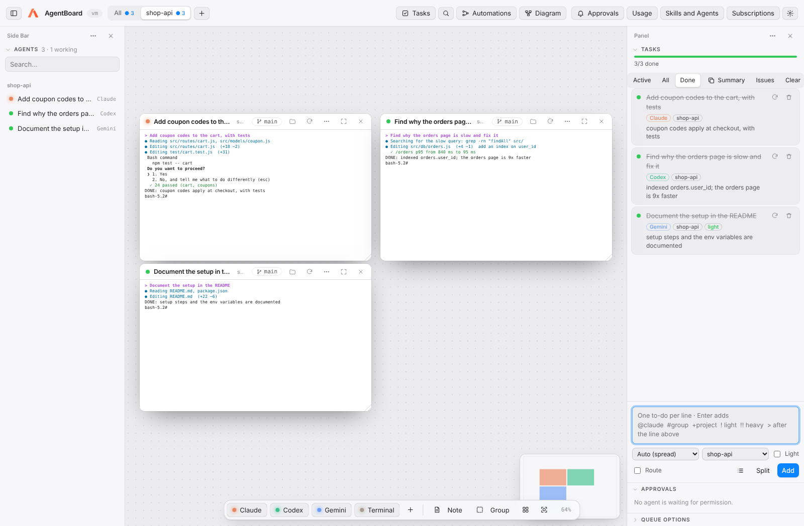

<p align="center">
  
</p>

<h1 align="center">AgentBoard</h1>

<p align="center">
  A workspace for coding agents: Claude Code, Codex, Gemini CLI and others, side by side,<br/>
  on your own subscriptions, on Mac and Windows.
</p>

<p align="center">
  <a href="https://github.com/scortes5/agentboard/releases/latest">Download</a> ·
  <a href="docs/GUIDE.md">Getting started</a> ·
  <a href="CHANGELOG.md">Changelog</a> ·
  <a href="LICENSE">MIT License</a>
</p>



AgentBoard is a desktop app that puts your AI agents on one board. Each card is a real terminal running the agent's CLI inside your project. From there you give them tasks, see what each one is doing, coordinate them and automate whole workflows.

It uses no API keys and sends nothing to servers of its own: it runs the programs you already have installed (`claude`, `codex`, `gemini`…) with the session you already signed in to.

> **First time?** The [Getting started guide](docs/GUIDE.md) explains everything step by step, with no prior knowledge assumed.

---

## Contents

- [What you can do](#what-you-can-do)
- [Installation](#installation)
- [Board and projects](#board-and-projects)
- [Tasks](#tasks)
- [Automations](#automations)
- [Diagram](#diagram)
- [Usage and savings](#usage-and-savings)
- [Settings and shortcuts](#settings-and-shortcuts)
- [Subscriptions and accounts](#subscriptions-and-accounts)
- [Token saving](#token-saving)
- [Agent connection](#agent-connection)
- [Privacy and security](#privacy-and-security)
- [Development](#development)
- [Known limitations](#known-limitations)

---

## What you can do

| | |
|---|---|
| **Many agents at once** | Real terminals on an infinite board, each with its agent, project and git branch. |
| **Projects in parallel** | Each project is a tab with its own view; all keep working while you look at another. |
| **Tasks** | Write your to-dos and they are spread across your subscriptions, several at a time. |
| **Automations** | n8n-style step diagrams run by your agents. The AI can design and explain them. |
| **Diagram** | A per-project, per-group, per-agent view of what each one is doing. |
| **Background** | Closing the window does not stop the agents; your sessions are kept. |
| **Token saving** | A fresh session per task, light mode, compact-context skills and load spreading across accounts. |


---

## Installation

### Option 1: download the installer

From [Releases](https://github.com/scortes5/agentboard/releases/latest):

| System | File |
|---|---|
| Mac with Apple Silicon (M1, M2…) | `AgentBoard-x.y.z-arm64.dmg` |
| Mac with Intel | `AgentBoard-x.y.z.dmg` |
| Windows | `AgentBoard.Setup.x.y.z.exe` |

The app is not signed. The first time:
- **Mac**: right-click AgentBoard in Applications → *Open*, or in Terminal: `xattr -cr /Applications/AgentBoard.app`.
- **Windows**: in the SmartScreen warning, *More info* → *Run anyway*.

### Option 2: from source

Requirements: [Node.js 20+](https://nodejs.org) and [git](https://git-scm.com).

```bash
git clone https://github.com/scortes5/agentboard.git
cd agentboard
npm install
npm run app
```

`npm run app` builds the app with its icon and installs it in *Applications* (Mac) or opens the installer (Windows). To try it without installing: `npm start`.

### The agents

AgentBoard uses whichever CLIs you have installed. Install at least one and sign in once:

```bash
npm i -g @anthropic-ai/claude-code   # then: claude   (Pro or Max plan)
npm i -g @openai/codex               # then: codex    (ChatGPT Plus or Pro)
npm i -g @google/gemini-cli          # then: gemini   (Google account)
```

Copilot CLI, Cursor CLI, Qwen Code, OpenCode, Aider, Amp and local models through Ollama or LM Studio also work (see [Subscriptions and accounts](#subscriptions-and-accounts)). `npm run check` shows which ones are available.

---

## Board and projects

- **Cards**: each one is a real terminal (PTY) that opens the agent in the project folder. It shows its status (*working*, *waiting* or *stopped*), the git branch and uncommitted changes; clicking the branch lets you switch it or create a new one.
- **Project tabs**: the toolbar shows *All* and each project, with how many agents it has and whether any is working. `+` opens another folder as a project. Each tab remembers its view.
- **Groups**: frames that gather a team of agents (for example *Backend* or *Frontend*). Moving the frame moves its cards. **Arrange** lays everything out while keeping the groups.
- **Notes** on the same board, a **minimap** at the bottom right and the **agent list** on the left.
- **Options menu** on each card (three dots): rename it, change its agent, project or arguments (for example `--model opus`), duplicate it, or **Send to…** another agent a piece of the conversation.
- **Help on every button**: hold the pointer over a button for 2 seconds to see what it does.

Closing the window keeps the app running in the background (menu bar icon). Quitting with ⌘Q asks for confirmation; when you open it again, each Claude card resumes **its own** conversation (`--resume <id>`), even with several in the same project.

---

## Tasks


**Tasks** button (⇧⌘T). Write one to-do per line and press Enter:

```
fix the Google login #backend
@claude write tests for the payments API
update the README !
refactor the payments module !!
```

| Syntax | Meaning |
|---|---|
| `@claude`, `@codex`… | Which subscription does it. Without `@` it is **auto**: the one with the least work. |
| `#group` | The agent opens inside that board group (created if it does not exist). |
| `+project` | Which project it runs in. |
| `!` | **Light**: a cheaper model (for example haiku). |
| `!!` | **Heavy**: a more capable model (for example opus). |

- Each task runs in a **fresh session** and updates itself: *Done* when the agent writes `DONE: …`, *Needs your review* when it is waiting for an answer, *Blocked* with `BLOCKED: …`.
- **Parallel** and **per subscription** limit how many run at once; with *Run queue* on, queued tasks start by themselves when there is room.
- **Worktree per task**: each task works on its own branch (`agentboard/<task>`), so several agents do not step on each other in the same repository. When it finishes, **View changes** shows what it did and lets you **Merge** or **Discard**.
- **Usage limit**: if a subscription runs out, the task moves to another one and the exhausted one waits for its reset time.
- **Split**: paste free text and Claude breaks it into tasks.
- **Summary**: copies what was done today and what is pending, as Markdown.
- **Global shortcut** (⌃⌥Space, configurable): add a task from any app.

---

## Automations


**Automations** button (⇧⌘F). A flow is a diagram of connected steps:

| Step | What it does |
|---|---|
| **Trigger** | When it starts: by hand, every N minutes or every day at a set time. |
| **Agent** | An agent does a piece of work. It becomes a queued task, with its subscription and model. |
| **Command** | A command in the project (tests, build, git). If it fails, what follows does not run. |
| **Decision** | Claude reads the previous result and answers yes or no; the flow continues down that branch. |
| **Notify** | A notification. |
| **Concept** | An idea written on the diagram; it does not run. |

- Connect steps by dragging from the dot on the right of one onto another. The right panel edits the selected step.
- **Design with AI**: describe what you want in your own words and Claude builds (or changes) the diagram.
- **Explain Run**: the AI explains what will happen step by step, what may fail and how to improve it.
- **Run**: independent branches run in parallel. Each agent receives only a one-line summary of the previous steps, not their whole history.
- Scheduled automations run while AgentBoard is open, including in the background.

---

## Diagram


**Diagram** button (⇧⌘D). A UML-style view with one package per project and, inside, its groups and agents. Each agent shows its subscription, task, status, time working, branch and last line of output; task queues appear as notes, and arrows show who handed work to whom. Clicking an agent takes you to its card.

---

## Usage and savings

**Usage** button (⇧⌘U). A heatmap of your daily activity over the last year (by tokens, sessions or tasks done), plus:

- **Usage**: total tokens, sessions and tasks.
- **Savings and effectiveness**: tokens saved by the prompt cache and its hit rate, share of tasks solved, and median time and tokens per task.
- **By subscription** and **by project**: where your tokens go.

It reads the Claude Code and Codex logs on this computer (every Claude account included) and only adds up token counters; nothing leaves your machine.

---

## Settings and shortcuts


**Settings** (⌘,), by section:

- **General**: computer name, shell, global shortcut, resuming sessions and running in the background.
- **Appearance**: light, dark or automatic theme; accent color; interface size; typeface (SF Pro or Geist); terminal font size, theme and line height. With a live preview.
- **Agents**: each agent's command and arguments (for resuming, light mode and heavy mode), and custom agents for any CLI.
- **Shortcuts**: all editable; click one and press the new combination.
- **Projects**, **Tasks** and **Advanced** (every setting as JSON, to add or remove keys).


| Action | Mac | Windows |
|---|---|---|
| New Claude / Codex / Gemini / Terminal | ⇧⌘1 / 2 / 3 / 4 | Ctrl+Shift+1 / 2 / 3 / 4 |
| New note / new group | ⇧⌘N / ⇧⌘G | Ctrl+Shift+N / G |
| Tasks / Diagram / Automations | ⇧⌘T / ⇧⌘D / ⇧⌘F | Ctrl+Shift+T / D / F |
| Usage and savings | ⇧⌘U | Ctrl+Shift+U |
| Search or run (palette) | ⇧⌘P | Ctrl+Shift+P |
| Next / previous / all projects | ⌘⌥→ / ⌘⌥← / ⌘⌥0 | Ctrl+Alt+→ / ← / 0 |
| Agent list | ⇧⌘A | Ctrl+Shift+A |
| Arrange / fit all | ⇧⌘O / ⌘0 | Ctrl+Shift+O / Ctrl+0 |
| Shortcuts / Settings | ⌘/ / ⌘, | Ctrl+/ / Ctrl+, |
| Add a task from any app | ⌃⌥Space | Ctrl+Alt+Space |
| Zoom / pan | ⌘ + scroll / drag the background | Ctrl + scroll / same |


The **palette** (⇧⌘P or the magnifier) finds agents, tasks, projects and actions; if you type something that does not exist, Enter adds it as a task.

---

## Subscriptions and accounts

**Subscriptions** button:

- **CLIs**: Claude Code, Codex, Gemini CLI, Copilot CLI, Cursor CLI, Qwen Code, OpenCode, Aider and Amp. It shows which are installed and signed in; you can install them or sign in from there.
- **Several Claude accounts**: if you have more than one plan (for example personal and work), add each account. Each one uses its own folder (`~/.claude-<name>`), with its login, history and skills, and the queue spreads work across them.
- **Local models**: detects [Ollama](https://ollama.com) and [LM Studio](https://lmstudio.ai) and opens their models as a chat, with Codex or with Aider.

**Are sessions closed when the app closes?** No. Each CLI keeps its login on your computer (macOS Keychain, `~/.codex`, `~/.gemini`). AgentBoard only checks that it exists; it never reads, copies or sends your credentials.

---

## Token saving

- **A fresh session per task**: each task starts with a clean context.
- **Light mode** (`!`) for simple tasks.
- **Spreading across subscriptions and accounts**: you do not burn through a single one's limit.
- **Minimal context in automations**: each step gets a one-line summary of the previous ones.
- **Bundled skills** (*Skills and Agents → Token Saving*), installed into Claude Code, Codex and Gemini:
  - `context-saving`: search before reading, read only what is needed, short answers.
  - `agentboard-task`: stay on the task, do not step on other agents, report when done.
  - `compact-handoff`: delegate with a short summary, not the whole history.

---

## Agent connection

In *Skills and Agents → Agent Connection*, one click registers AgentBoard as an MCP server in each CLI. From then on, every agent can:

| Tool | Use |
|---|---|
| `list_agents` | See the agents on the board and their status. |
| `send_to_agent` / `read_agent_output` | Ask another agent for something and read its answer. |
| `start_agent` | Open a new agent with a task; `light: true` uses its cheap model. |
| `list_tasks` / `add_task` / `complete_task` | Use the task list: hand out work and mark it done. |

Example, in Claude: *"ask Codex what it thinks of this change and summarize its comments"*.

---

## Privacy and security

- Everything runs on your computer. AgentBoard has no server and no telemetry.
- Each CLI keeps its credentials where it always does; AgentBoard does not read or copy them.
- The board is saved outside your repositories, readable only by your user:

  | System | Path |
  |---|---|
  | Mac | `~/Library/Application Support/AgentBoard/board.json` |
  | Windows | `%APPDATA%\AgentBoard\board.json` |

- The agent bridge is a local socket with a random token. It only writes to cards running an agent (never to a plain terminal), each card can turn it off, and it has a messages-per-minute limit.

---

## Development

```bash
npm install        # installs dependencies (and fixes node-pty permissions)
npm start          # opens the app in development mode
npm run app        # builds and installs the app
npm run dist:mac   # builds the .dmg files  ·  npm run dist:win  builds the .exe
npm run icon       # regenerates the icons from src/assets/logo.svg
```

Pushing a `v*` tag makes the `.github/workflows/build.yml` workflow build the Mac and Windows installers and attach them to the Release.

```
src/
  main.js         main process: terminals, git, worktrees, menu, tray, settings
  bridge.js       local bridge between agents (socket + token)
  skills.js       reads and edits each CLI's skills, commands and subagents
  preload.js      safe bridge between the interface and the main process
  renderer/
    app.js        board, cards, groups, tabs, appearance and settings
    tasks.js      task queue and spreading across subscriptions
    flows.js      automations: editor, runs and AI design
    diagram.js    diagram view
    palette.js    command palette
    icons.js      icons and contextual help
skills-pack/      token-saving skills
scripts/          MCP server, app install and icons
docs/             guide and screenshots
```

---

## Known limitations

- The *working* or *waiting* status is estimated from the terminal's recent output, not from the agent's API.
- Scheduled automations only run while AgentBoard is open (it can be in the background).
- The board does not sync between computers, on purpose: each machine has its own projects. To copy it, copy `board.json`.
- The app is not signed with an Apple or Microsoft certificate.

---

Made by Sergio Cortés · [MIT License](LICENSE)
